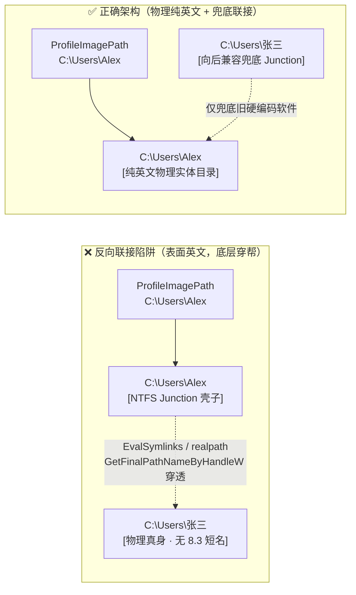

# WinProfileFixer — Windows 中文（非 ASCII）用户目录无损修复通用指南与防呆工具集

> 简体中文 | [English](README_EN.md)

[](#)
[](#)
[](LICENSE)

一套源自真实排障实战的 **Windows 中文（或含空格/非 ASCII 字符）用户目录无损迁移、反向联接翻转与全套收尾脚本**。

支持 **0 字节拷贝原地原子重命名**（完整保留数十 GB 的 WSL2、开发环境与 NTFS 权限），内置 **8 项前置安全守卫**、**先测锁再改动零损中止机制**、**`CldFlt` 云文件内核锁诊断**、**WSL2/环境变量/Shell Folders 一键收尾**以及**乱码幽灵目录防误删清理**。

---

## 目录

- [一、为什么中文用户目录是开发者的噩梦？](#一为什么中文用户目录是开发者的噩梦)
- [二、警惕：网传「最无损软链接教程」的致命陷阱](#二警惕网传最无损软链接教程的致命陷阱)
- [三、三大修复方案对比与选型](#三三大修复方案对比与选型)
- [四、本工具集支持的两种自动识别场景](#四本工具集支持的两种自动识别场景)
- [五、五阶段标准修复流程（实战手把手）](#五五阶段标准修复流程实战手把手)
- [六、脚本清单与参数速查](#六脚本清单与参数速查)
- [七、真实修复历程与深度文档](#七真实修复历程与深度文档)
- [八、新装系统如何一劳永逸避坑？](#八新装系统如何一劳永逸避坑)

---

## 一、为什么中文用户目录是开发者的噩梦？

在 Windows 首次开机引导（OOBE）中登录微软账户时，Windows 会自动取账户名/姓名前几个字符生成 `C:\Users\<用户名>`。一旦这个目录包含中文（或其他非 ASCII 字符、空格），后续开发和日常使用中会接连爆发四类顽疾：

1. **工具链与编译器崩溃**：Go、Rust、Python、C/C++ 工具链（CMake / MinGW / MSVC）、QEMU、Docker、AI Agent 沙盒等底层库对非 ASCII 路径或 GBK/UTF-8 混用支持极差。
2. **NTFS 8.3 短路径盲区**：很多工具遇到非 ASCII 路径时会调用 Win32 `GetShortPathNameW` 尝试降级为纯 ASCII 短路径（`~1`），但 **2~4 个汉字（如 3 个汉字 = 6 字节 GBK ≤ 8 字节）天然符合 8.3 长度规则，NTFS 根本不会为其生成 ASCII `~1` 短名**，导致降级兜底也直接失败！
3. **静默生成数 GB 乱码幽灵目录**：简体中文 Windows 默认系统代码页为 `ACP/OEMCP = 936`（GBK）。当某些跨平台软件将 UTF-8 路径按 GBK 错误解码写入时，会在 `C:\Users\` 下偷偷生成形如 `C:\Users\寮犱笁\AppData`（`张三\` 的 UTF-8 字节按 GBK 解码）的乱码目录，悄无声息吃掉数 GB 的 C 盘空间。
4. **环境变量与跨平台脚本截断**：Node.js / npm / pip / Claude / Codex / LM Studio 等工具默认将配置和缓存写入 `%USERPROFILE%`，中文路径会导致 CLI 参数转义失败、配置文件解析报错。

---

## 二、警惕：网传「最无损软链接教程」的致命陷阱

很多中文教程为了“省事、不碰原目录”，会教你这样做：

> ❌ **错误方向（反向联接壳子）**：保留物理目录 `C:\Users\张三` 不动 → 创建 `mklink /J C:\Users\Alex C:\Users\张三` → 把注册表 `ProfileImagePath` 改成 `C:\Users\Alex`。

这套做法**表面上 `%USERPROFILE%` 变成了英文，实际上埋了更大的雷**：



- **路径规范化直接穿帮**：Go（`filepath.EvalSymlinks`）、Win32（`GetFinalPathNameByHandleW`）、Python（`os.path.realpath`）、Node.js（`fs.realpathSync`）、Rust（`fs::canonicalize`）全部会穿透 `C:\Users\Alex` 还原出物理真身 `C:\Users\张三`；部分工具（如 Go 的 `EvalSymlinks` 场景）遇到用户根目录是 Junction 甚至直接报错。
- **违反微软支持规范**：`ProfileImagePath` 指向重解析点（Reparse Point）不受微软官方支持，Windows 11 大版本升级（如 `23H2 -> 24H2/25H2`）与 UWP/Microsoft Store 易出异常。

> 详细原理分析请参阅 [docs/ARCHITECTURE.md](docs/ARCHITECTURE.md)。

---

## 三、三大修复方案对比与选型

| 方案 | 原理 | 数据/软件保留 | 耗时 | 适用人群 |
| :--- | :--- | :--- | :--- | :--- |
| **方案 A：原地无损改名 / 翻转方向（本工具核心 ⭐）** | 安全模式下 0 字节原子重命名实体目录为纯英文 + 同步 `ProfileImagePath` + 留旧名兜底 Junction + 清理 WSL2/注册表残留 | **100% 原地保留**（含几十 GB WSL、IDE 与登录态） | **10~15 分钟** | 电脑已深度配置大量开发工具与数据，不想重装折腾一整天 |
| **方案 B：新建纯英文管理员账户并迁移** | 新建纯英文本地账号 → 手动迁移文档/SSH/WSL → 重新绑定微软账户 | 需重配用户级软件与登录态 | 半天 ~ 1 天 | 新电脑、刚装完系统，或有极致系统洁癖 |
| **方案 C：重装系统（OOBE 建英文账户）** | 全盘重装，断网建本地英文账户后再绑微软账户 | 全部重来 | 半天 ~ 1 天 | 本身准备升级/重装系统 |

---

## 四、本工具集支持的两种自动识别场景

核心脚本 [`scripts/03-Migrate-UserProfile.ps1`](scripts/03-Migrate-UserProfile.ps1) 会自动读取 `ProfileList` 注册表与 NTFS 重解析点，**无需手工区分命令**，自动匹配两种模式：

1. **`Standard` 模式（标准中文物理目录无损改名）**
   - **现状**：`C:\Users\张三` 是物理实体，`ProfileImagePath` 指向 `C:\Users\张三`，`C:\Users\Alex` 尚不存在。
   - **动作**：测锁原子改名 `张三 -> Alex_RENAMING_TMP -> Alex` → 更新 `ProfileImagePath` → 建立兜底联接 `张三 [Junction] -> Alex`。
2. **`Flip` 模式（反向联接安全翻转）**
   - **现状**：`C:\Users\张三` 是物理实体，`C:\Users\Alex` 是指向 `张三` 的 Junction，且 `ProfileImagePath` 已经指向 `C:\Users\Alex`。
   - **动作**：**先原子改名实体 `张三 -> Alex_RENAMING_TMP` 测锁**（若被占用立刻零改动退出！）→ 仅删除已悬空的旧 `Alex` 联接壳子 → 实体原子落位 `Alex` → 建立正确方向的兜底联接 `张三 [Junction] -> Alex`。

---

## 五、五阶段标准修复流程（实战手把手）

> [!IMPORTANT]
> **切勿将本工具仓库放在 `C:\Users\<待迁移目录>` 内部运行！**
> 请将本仓库克隆或解压到 `C:\Users` 之外的纯英文路径（例如 `D:\WinProfileFixer` 或 `C:\WinProfileFixer`），避免脚本进程自身锁定待重命名的用户目录。

### 阶段 1：只读深度体检（日常账户下运行）

在当前日常账户中，以**管理员身份**打开 PowerShell，运行只读体检：

```powershell
Set-ExecutionPolicy -Scope Process -ExecutionPolicy Bypass
cd D:\WinProfileFixer
.\scripts\01-Audit-UserProfile.ps1
```

体检脚本 **100% 只读**，会帮你一次查清：
- 你属于 `Standard` 还是 `Flip` 场景、8.3 短名是否存在盲区；
- `C:` 盘是否加载了 **`CldFlt`（OneDrive 云文件内核锁）** 或杀软驱动（若存在，必须进安全模式！）；
- `C:` 盘是否开启了 **BitLocker**（若开启，进安全模式前务必先备好 48 位恢复密钥或临时暂停保护）；
- 是否存在 **WSL2 `BasePath` 含中文**（重头避坑点！）、环境变量残留、乱码幽灵目录。

---

### 阶段 2：前置安全备份（日常账户下以管理员运行）

```powershell
.\scripts\02-Backup-BeforeMigrate.ps1 -BackupDir D:\WinProfileBackup
```

该脚本会自动完成：
- 安全执行 `wsl --shutdown`；
- 导出 9 个核心注册表分支（`ProfileList`、`UserManager`、`SyncRootManager`、`Lxss`、`User Shell Folders`、`Shell Folders`、`Environment`、`Run`、`OneDrive`）到 `D:\WinProfileBackup`；
- 保存迁移前 `C:\Users` 目录结构、重解析点与 `icacls` NTFS ACL 快照；
- 创建 Windows 系统还原点 `WinProfileFixer_Before_Migration`。

同时准备一个**不同于日常账户的管理员账号**（例如临时启用内置 `Administrator` 并设定一个记得住的密码）：

```powershell
net user Administrator /active:yes
net user Administrator "YourTempStrongPass123!"
```

---

### 阶段 3：进「安全模式」执行核心原子迁移/翻转（约 2 分钟）

> [!WARNING]
> **为什么强烈建议直接进单次「安全模式 (按 4)」，且必须「先注销再重启」？**
> 1. **防 Win11 ARSO 预加载锁**：如果直接点重启或「切换用户」，Win11 的自动重启登录机制（ARSO）会在锁屏后台悄悄加载日常账户的 `NTUSER.DAT`，导致目录被系统锁定。
> 2. **绕开 `CldFlt` 与杀软内核锁**：即使日常账户已彻底注销且 OneDrive 未运行，只要目录内有 OneDrive 云同步根，内核驱动 `cldflt.sys` 仍会拦截父目录重命名并报 `Access is denied`。**单次安全模式不加载 `CldFlt` 与第三方杀软驱动，可一次 1 秒必过！**（重启后自动恢复正常模式，无需改 `msconfig`。）

**操作步骤：**
1. 正常退出正在运行的虚拟机/沙盒软件（如 QEMU / Docker / WSL）。
2. 开始菜单 → 点击头像 → **注销（Sign out）**日常账户（绝不要用「切换用户」）。
3. 退到登录界面后，**按住键盘 `Shift` 键不放** → 点击右下角电源图标 → **重启**。
4. 蓝屏恢复菜单依次选择：**疑难解答 → 高级选项 → 启动设置 → 重启**。
5. 重启出现数字列表后，按键盘 **`4`**（启用安全模式）。
6. 登录界面左下角选择 **`Administrator`** 登录。
7. 打开 `D:\WinProfileFixer\scripts\launchers\`，右键 **`Run-Migrate-Interactive.cmd` → 以管理员身份运行**（或在管理员 PowerShell 中运行）：

```powershell
# 建议先 -DryRun 预检 8 项安全守卫全部 [OK]
.\scripts\03-Migrate-UserProfile.ps1 -DryRun

# 正式执行（按提示输入大写 YES 确认）
.\scripts\03-Migrate-UserProfile.ps1
```

8. 等待 1~2 秒看到绿色 **`迁移与全部验收通过！`**（且 `GetFinalPathNameByHandleW` 返回 `\\?\C:\Users\<你的英文名>`），直接点击开始菜单 **重启**电脑（自动恢复正常模式）。

---

### 阶段 4：切回日常账户做全套收尾（非常重要！）

正常登录回你的日常账户后，**先不要急着启动 WSL！**（此时 WSL2 注册表 `Lxss\BasePath` 仍指着旧路径，Hyper-V 无法经由 Junction 挂载 `ext4.vhdx`。）

以**管理员身份**打开 PowerShell 运行收尾脚本：

```powershell
Set-ExecutionPolicy -Scope Process -ExecutionPolicy Bypass
cd D:\WinProfileFixer

# 先预演确认要改的每一项
.\scripts\04-PostMigrate-Cleanup.ps1 -DryRun

# 正式执行收尾（附带 -DisableBuiltInAdmin 顺手关闭临时启用的内置 Administrator）
.\scripts\04-PostMigrate-Cleanup.ps1 -DisableBuiltInAdmin
```

该脚本会自动完成：
- 修正所有 WSL2 发行版的 `HKCU\...\Lxss\*\BasePath` 并自动冒烟启动验证；
- 保留 `REG_EXPAND_SZ` / `REG_SZ` 原生类型替换 `HKCU\Environment` 全部旧路径，并广播 `WM_SETTINGCHANGE`；
- 规范化 `User Shell Folders`（改为 `%USERPROFILE%`）与旧版 `Shell Folders`；
- 同步更新 OneDrive `UserFolder`、`HKLM\...\SyncRootManager`、`UserManager\UserPicture`、`HKCU\...\Run` 启动项及工具指针文件；
- 审计系统级环境变量、Windows 服务和计划任务；
- 自动关闭内置 `Administrator` 恢复安全基线，并验收 `GetFinalPathNameByHandleW` 与 Microsoft Store。

---

### 阶段 5（可选）：安全清理历史乱码幽灵目录与孤儿注册表

```powershell
# 第一步：默认只读审计，查看 C:\Users 下有哪些乱码/废弃目录及其大小
.\scripts\05-Clean-MojibakeDirs.ps1

# 第二步：核对名单无误后，指定目录名执行安全清理（内置跨目录联接防误删校验）
.\scripts\05-Clean-MojibakeDirs.ps1 -TargetNames "目录名1","目录名2" -Execute -CleanOrphanProfileKeys
```

> 备份目录（如 `D:\WinProfileBackup`）建议留存 **3~7 天**，确认日常所有软件、WSL、更新均顺畅后再删除。

---

## 六、脚本清单与参数速查

| 脚本路径 | 运行环境 | 权限 | 作用 |
| :--- | :--- | :--- | :--- |
| [`scripts/common/ProfileFixer.Common.psm1`](scripts/common/ProfileFixer.Common.psm1) | 公共模块 | — | Win32 P/Invoke (`GetFinalPathNameByHandleW` / `GetShortPathNameW` / `SendMessageTimeoutW`)、拓扑识别、守卫函数 |
| [`scripts/01-Audit-UserProfile.ps1`](scripts/01-Audit-UserProfile.ps1) | 日常账户 | 推荐管理员 | **100% 只读**深度体检，自动识别 `Standard`/`Flip` 场景、8.3 盲区、`CldFlt`、BitLocker、WSL2 与残留 |
| [`scripts/02-Backup-BeforeMigrate.ps1`](scripts/02-Backup-BeforeMigrate.ps1) | 日常账户 | 管理员 | 导出 9 项注册表备份 + NTFS ACL/重解析点快照 + 系统还原点 |
| [`scripts/03-Migrate-UserProfile.ps1`](scripts/03-Migrate-UserProfile.ps1) | **另一管理员（推荐安全模式）** | 管理员 | 核心原子迁移/翻转脚本（8 项前置守卫、`-DryRun`、自动回滚、4 项 Win32 硬核验收） |
| [`scripts/04-PostMigrate-Cleanup.ps1`](scripts/04-PostMigrate-Cleanup.ps1) | 日常账户（迁移后） | 管理员 | WSL2 `BasePath`、环境变量+广播、Shell Folders、OneDrive/SyncRoot、Run、关闭内置 Administrator |
| [`scripts/05-Clean-MojibakeDirs.ps1`](scripts/05-Clean-MojibakeDirs.ps1) | 日常账户 | 审计普通 / 删除管理员 | 审计并安全清理乱码幽灵目录与孤儿 `ProfileList` 项（含跨目录联接检测 + `robocopy /MIR /XJ`） |
| [`scripts/Rollback-UserProfile.ps1`](scripts/Rollback-UserProfile.ps1) | 另一管理员（安全模式） | 管理员 | 对称应急回滚脚本（支持 `Flip` 与 `Standard` 两种模式） |

---

## 七、真实修复历程与深度文档

- **[真实修复历程完整复盘（Case Study）](docs/CASE_STUDY.md)**：从一次 CLI/QEMU 报错出发，逐步揪出反向联接陷阱、8.3 短名盲区、7 GB 乱码目录、`CldFlt` 内核锁拦路、安全模式 1 秒翻转、WSL2 44.6 GB 虚拟盘零拷贝保全的完整工程纪实。
- **[底层技术原理与安全设计（Architecture）](docs/ARCHITECTURE.md)**：路径规范化穿透机制、NTFS 8.3 规则、GBK/UTF-8 乱码生成机理、4 步测锁原子状态机与防误删校验模型。
- **[常见报错排错与 FAQ（Troubleshooting）](docs/TROUBLESHOOTING.md)**：涵盖 `Access Denied`、`NTUSER.DAT` 占用、BitLocker、WSL2、OneDrive、`\\?\` 前缀解释、**Win11 大版本升级前临时移除兜底联接**等全部实战问题。

---

## 八、新装系统如何一劳永逸避坑？

> **社区金句：“初装系统不规范，日后开发两行泪。”**

以后换新电脑或重装 Windows 11 时，在 OOBE 首次开机设置阶段请务必记住：
1. **先建纯英文无空格本地账户**（如断网或在 OOBE 按 `Shift + F10` 执行 `oobe\bypassnro` / 使用新版 OOBE 本地账户选项），此时 Windows 会原生创建纯英文实体目录 `C:\Users\<EnglishName>`；
2. 进桌面之后，再在「设置 → 账户 → 你的信息」里**改用微软账户登录**——Windows 只会更改显示名称，**绝对不会再改动已生成的纯英文 `C:\Users\<EnglishName>` 目录名**，从源头杜绝 100% 历史债！

---

## 免责声明

修改 Windows 用户配置目录与核心注册表属于高权限系统级操作。尽管本工具集已经过严格的 PowerShell 5.1/7 语法验证、隔离沙盒测试与实机验证，并设计了 8 项前置守卫与测锁回滚机制，但仍请务必**先完整运行阶段 2 备份并确认重要数据已有异地备份**后再执行正式迁移。本项目按 [MIT License](LICENSE) 开源提供。
