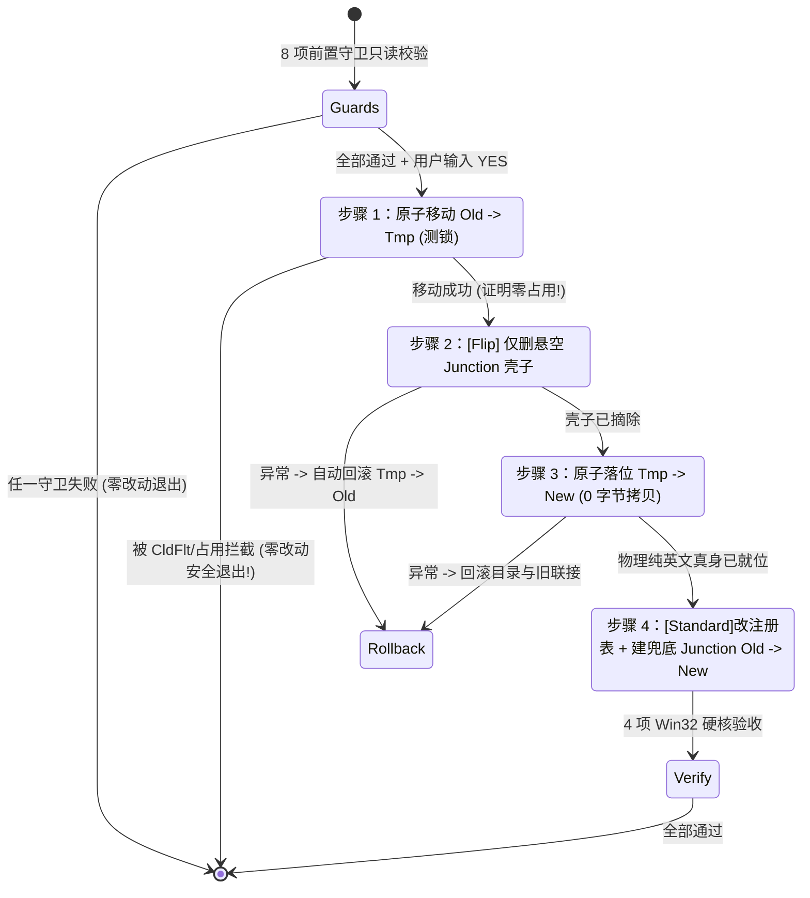

# 技术原理与安全模型深度解析（Architecture）

本文详细说明 Windows 中文（非 ASCII）用户目录引发各类顽疾的底层机制，以及 `WinProfileFixer` 每一条工程防线的设计依据。

---

## 1. 路径规范化（Path Canonicalization）为什么会击穿“反向联接”？

当用户采用错误的反向联接架构（`C:\Users\Alex [Junction] -> C:\Users\张三 [实体]`）时，许多现代语言运行时与系统 API 都会执行路径规范化（Canonicalization）来消除符号链接、重解析点与相对路径：

| 生态 / 运行时 | 规范化 API | 传入 `C:\Users\Alex\...` 后的实际行为 |
| :--- | :--- | :--- |
| **Win32 API** | `GetFinalPathNameByHandleW` | 直接穿透 NTFS Junction，返回 `\\?\C:\Users\张三\...` |
| **Go** | `filepath.EvalSymlinks` | 穿透并还原中文真身；在部分 Windows 版本/权限组合下遇用户根 Junction 甚至直接返回错误 |
| **Python** | `os.path.realpath` / `Path.resolve()` | 穿透返回 `C:\Users\张三\...` |
| **Node.js** | `fs.realpathSync` | 调用 `GetFinalPathNameByHandleW`，穿透返回 `C:\Users\张三\...` |
| **Rust** | `std::fs::canonicalize` | 调用 `GetFinalPathNameByHandleW`，返回 `\\?\C:\Users\张三\...` |

**根本推论**：只有当 `C:\Users\<EnglishName>` 本身成为 **NTFS 物理实体目录**，而旧中文名退居为仅兜底历史硬编码软件的 **NTFS Junction** 时，所有现代工具才能在逻辑路径和物理真身两层都获得 100% 纯英文路径。

---

## 2. NTFS 8.3 短路径盲区（为什么 2~4 个汉字没有 `~1` 短名？）

部分开发工具（例如 QEMU 封装器或 Go/Python 桥接层）在检测到非 ASCII 路径后，会调用 Win32 `GetShortPathNameW` 企图将其转为纯 ASCII 的 DOS 8.3 短文件名（例如 `C:\PROGRA~1`）。

但在简体中文 Windows（NTFS + OEMCP 936）下，NTFS 判断是否需要生成 8.3 别名时依据的是**文件名字符/字节是否超过 8.3 规范或含非法 8.3 字符（如空格、多点号）**：
- 若目录名只有 **2~4 个汉字**（如 `张三` = 4 字节 GBK，或 3 汉字 = 6 字节 GBK，均 ≤ 8 字节且不含空格），NTFS 认为其本身已满足 8.3 长度约束，**不会为其生成纯 ASCII 的 `~1` 短路径**；
- `GetShortPathNameW("C:\Users\张三")` 返回的依然是 **`C:\Users\张三`**！
- 此外，新版 Windows 10/11 在非系统卷或特定策略下默认关闭了 8.3 短名生成（`fsutil 8dot3name query`）。

因此，依赖 8.3 短路径绕过中文用户目录是一条随时会断裂的死胡同。

---

## 3. 乱码幽灵目录是怎么在 `C:\Users` 里长出来的？

简体中文 Windows 的默认系统区域代码页通常是 `ACP = 936` / `OEMCP = 936`（GBK / CP936）。

假设用户真实目录为 `C:\Users\张三\`：
1. 某跨平台工具或 Electron/C++ 子模块把 `张三\` 编码为 **UTF-8 字节流**：`E5 BC A0 E4 B8 89 5C`（7 字节）；
2. 下游调用了非 Unicode 的 ANSI API（如 `CreateDirectoryA` / `fopen`）或以系统默认代码页 GBK（每 2 字节拼一个汉字）去解释这串 UTF-8 字节；
3. 末尾的 1 字节反斜杠 `0x5C`（`\`）甚至可能与前一个汉字 UTF-8 字节的尾字节粘连，组合成一个完全不同的 GBK 汉字（例如 `奬`），从而把 `C:\Users\张三\AppData` 错误拼接成了同级的 **`C:\Users\寮犱笁AppData`**（或类似乱码目录）！
4. 这些工具每次运行都把日志、缓存、运行时二进制静默写进乱码目录，在文件资源管理器里极容易被当成系统垃圾忽略，日积月累吞掉数 GB 空间。

---

## 4. `CldFlt` 云文件内核锁为什么会在“无人登录”时拦截重命名？

即使你已经注销了日常账户、重启进了 `Administrator`、甚至用 `HKEY_USERS\<SID>` 确认 `NTUSER.DAT` 完全未加载，在正常模式下重命名 `C:\Users\<旧目录>` 仍可能遭遇：

```text
Exception calling "Move" with "2" argument(s):
"Access to the path 'C:\Users\...' is denied."
```

底层原因在于 **Windows Cloud Files Mini Filter Driver（`CldFlt` / `cldflt.sys`）**：
- 只要该用户目录曾启用过 OneDrive（哪怕 OneDrive 现在没运行、没登录），其子目录 `OneDrive` 仍带有 NTFS 云占位重解析标记（Tag `0x9000701a`），并在 `HKLM\SOFTWARE\Microsoft\Windows\CurrentVersion\Explorer\SyncRootManager` 中注册了同步根；
- `CldFlt` 作为内核层文件系统微过滤驱动常驻挂载在 `C:` 卷上（可通过 `fltmc instances -v C:` 查见）；
- 为防止同步根路径失配，`CldFlt` 在内核 `IRP_MJ_SET_INFORMATION`（`FileRenameInformation`）回调中会直接拒绝重命名包含任何已注册 SyncRoot 的父目录，返回 `STATUS_ACCESS_DENIED`。

**解决方案（双保险）**：
1. **最优解（100% 推荐）**：进入单次 **Windows 最小安全模式（SafeBoot = 1）**。在 `HKLM\SYSTEM\CurrentControlSet\Control\SafeBoot\Minimal` 白名单中，**不包含 `CldFlt` 与绝大多数第三方杀软微过滤驱动**，从根源实现零拦截 1 秒原子重命名；
2. **备选解（正常模式脚本兜底）**：`03-Migrate-UserProfile.ps1` 在正常模式下检测到 `CldFlt` 时会自动尝试 `fltmc detach CldFlt C:`（并在 `finally` 中重新 `attach`），如遇其他驱动（如杀软 `sysdiag`）拦截，则会零改动安全退出并提示进安全模式。

---

## 5. 原子状态机与“先测锁再改动”安全不变量

以最危险、最容易把系统玩坏的 **`Flip`（反向联接翻转）** 为例，传统手工教程往往让用户**先删 `C:\Users\Alex` 联接，再去重命名 `C:\Users\张三`**——一旦重命名因 `CldFlt` 或文件占用失败，用户就会陷入“联接已删、目录未改、切回日常账户直接变临时配置文件/进不去桌面”的灾难状态！

`WinProfileFixer` 的状态机把最可能失败的锁检测放在**第一步**，建立严格的安全不变量：



### 关键工程细节
- **0 字节拷贝与完整 ACL 保留**：同卷下 `[System.IO.Directory]::Move()` 仅修改 NTFS MFT 父目录项，不复制任何文件块（哪怕目录里有 200 GB 数据也是毫秒级完成），原有 SID 所有权、NTFS DACL 与 AppContainer 权限 100% 原封不动。
- **绝不递归删 Junction**：删除旧 Junction 壳子前二次校验 `ReparsePoint` 属性，并调用 `[System.IO.Directory]::Delete($path, $false)`（非递归仅摘除重解析点），彻底杜绝像旧版工具那样误删实体文件的惨剧。
- **注册表值类型保真**：修改 `ProfileImagePath` 与 `HKCU\Environment` 时，严格通过 .NET `RegistryKey.GetValue(..., DoNotExpandEnvironmentNames)` 和 `GetValueKind()` 读写，避免把 `REG_EXPAND_SZ`（如 `%USERPROFILE%\...`）错误展平为 `REG_SZ`。

---

## 6. 乱码目录防误删清理引擎（阶段 5）

直接对 `C:\Users` 下的未知目录运行 `Remove-Item -Recurse -Force` 存在两大风险：
1. **跨目录联接误伤**：如果待删目录内部嵌套了指向真实用户目录（如 `C:\Users\Alex`）的 Junction，某些版本 PowerShell 的递归删除会沿着联接删空真实数据；
2. **260 字符 MAX_PATH 失败**：Node.js / Codex / 浏览器缓存中常存在深度超过 260 字符的子路径，普通删除中途卡死。

`05-Clean-MojibakeDirs.ps1` 的三道防线：
1. **默认只读 + 全量保护集**：自动将所有活跃 `ProfileList` 路径、其 `FinalPath`、所有指向受保护目录的兜底 Junction 以及 Windows 系统目录加入不可删除白名单；
2. **跨目录联接扫描**：删除前先扫描待删目录内部（Depth 4）所有 `ReparsePoint`，若有任何目标指向受保护用户目录，立即中止退出；
3. **空目录镜像排除联接删除**：先非递归摘除内部安全联接，再用 `robocopy <空目录> <目标> /MIR /XJ`（`/XJ` 严格禁止跟踪任何 Junction，同时原生支持超长路径），最后用 `\\?\` 扩展路径删除空壳根目录。
